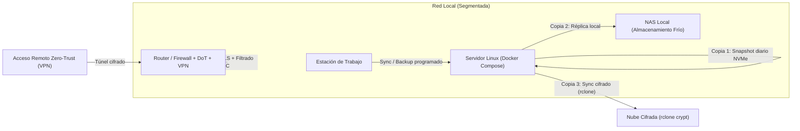

# Homelab 3-2-1 Backup & Infrastructure Architecture

Documentación técnica de referencia y plantillas genéricas para diseñar una infraestructura Linux/Docker autoalojada con **estrategia de copias de seguridad 3-2-1**, **seguridad perimetral** y **operación automatizada**.

> **Nota sobre la automatización y plantillas:**  
> La arquitectura, los criterios de continuidad, las reglas de red y la validación operativa han sido definidos y supervisados por el autor. Los scripts de ejemplo y automatización de apoyo han sido elaborados mediante **ingeniería asistida por IA** y parametrizados aquí de forma genérica sin datos sensibles.

---

## Arquitectura General



---

## Pilares del Diseño

1. **Regla 3-2-1 Real y Verificada:**
   - **3 copias:** datos activos en producción + réplica en NAS local + copia cifrada fuera de sede en la nube.
   - **2 soportes distintos:** disco NVMe del servidor Linux + almacenamiento dedicado en NAS.
   - **1 copia externa cifrada:** sincronización automatizada mediante `rclone` con cifrado en cliente (`crypt`).
2. **Validación Pre-Vuelo y Tolerancia a Fallos:**
   - Comprobación de espacio libre en disco (`df -Pm`) antes de volcar bases de datos o empaquetar volúmenes.
   - Reintentos controlados en subidas a la nube y limpieza de archivos parciales ante fallos.
3. **Endurecimiento de Contenedores y Red:**
   - Montajes en solo lectura (`:ro`) cuando el servicio no requiere escritura.
   - Rotación estricta de logs (`json-file` `max-size` / `max-file`) y `healthcheck` nativo en cada servicio.
   - Resolución DNS cifrada (**DNS-over-TLS**) y acceso remoto únicamente a través de **VPN**.

---

## Contenido del Repositorio

```text
homelab-321-architecture/
├── README.md
├── docs/
│   ├── backup-strategy-321.md        # Diseño detallado de copias 3-2-1, retención y auditoría
│   └── network-security-hardening.md # Guía de endurecimiento de red, DNS y contenedores
└── templates/
    ├── .env.example                  # Variables parametrizadas (rutas, umbrales y remoto rclone)
    ├── lib_backup.sh                 # Librería Bash compartida (logging, espacio libre, reintentos)
    └── backup_example.sh             # Script de ejemplo para backup de volúmenes Docker + PostgreSQL
```

---

## Uso de las Plantillas

```bash
cp templates/.env.example templates/.env
# Edita templates/.env con tus rutas locales y el nombre de tu remoto rclone cifrado
chmod +x templates/backup_example.sh
./templates/backup_example.sh
```
